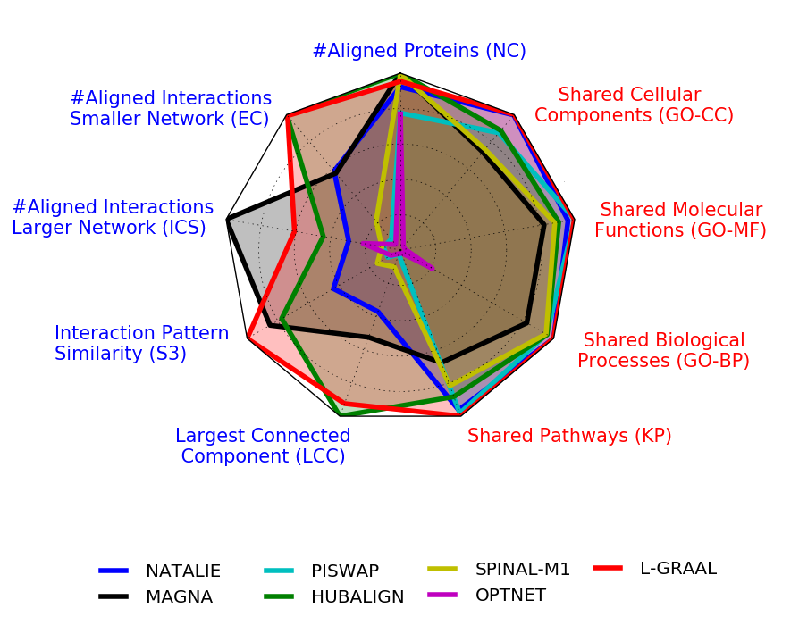

# Unified Alignment of Protein-Protein Interaction Networks

**Supplementary data**

**N. Malod-Dognin, K. Ban and N. Pržulj**

Corresponding author: Prof. N. Pržulj, natasa.przulj@mbzuai.ac.ae

We provide here the datasets and the scripts that we used in the paper.

## Downloads

- [Datasets](https://github.com/przulj-lab/ulign/releases/download/v1.0/Datasets.zip)
- [Ulign Python script for unifying network alignments](https://github.com/przulj-lab/ulign/releases/download/v1.0/Ulign.zip)

## Network aligners used in our study

In alphabetical order:

- [HubAlign](https://home.ttic.edu/~hashemifar/#softwares)
- [L-GRAAL](https://github.com/przulj-lab/L-GRAAL)
- [MAGNA++](http://www3.nd.edu/~cone/MAGNA++/)
- [NATALIE](http://www.mi.fu-berlin.de/w/LiSA/Natalie)
- [OptNet](https://github.com/crclark/optnetaligncpp)
- [PISwap](https://cb.csail.mit.edu/cb/piswap/webserver/)
- [SPINAL](https://code.google.com/archive/p/spinal/)

## Citation

N. Malod-Dognin, K. Ban and N. Pržulj. Unified alignment of protein-protein interaction networks. *Scientific Reports* 7, 953 (2017). https://doi.org/10.1038/s41598-017-01085-9
